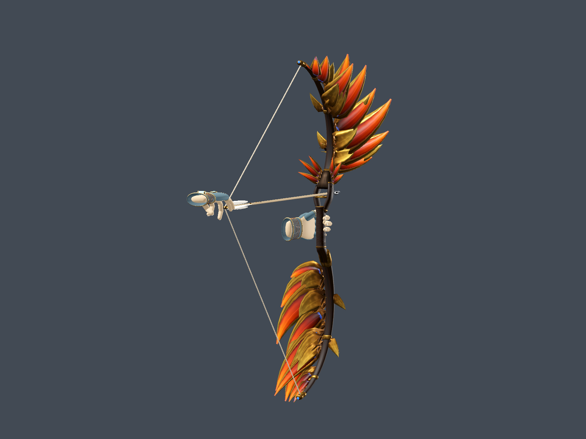
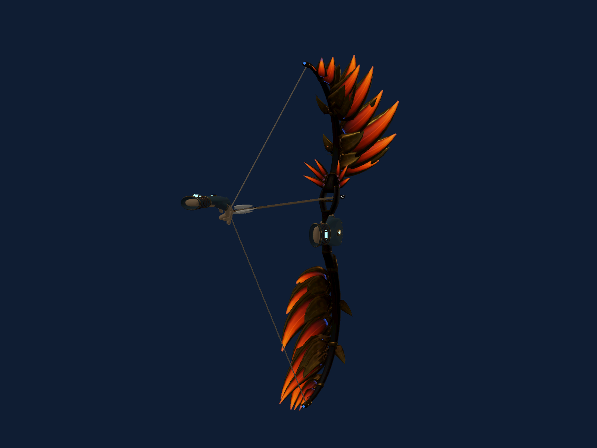

# Emberwing physical and visual refinement

The designer review identified a real ergonomic fault: the arrow travelled
through the middle of the gripping fingers. Revision 3 replaces that bore with
a solid oval grip and a raised, open sight window. The string's braced nock is
at `(0, .115, .10)` and the physical guide at `(0, .115, -.012)` in bow metres.
The sculpted phoenix and cambered feather roots sit outside that corridor.

Upper and lower limbs now have their own authored root pivots. The string-tip
markers are children of those limbs; runtime string endpoints use their full
world transforms, so they follow draw movement while staying seated in their
fittings. Physical draw aims through the guide. Small shared material copies
give draw and curve mode an emissive response without adding lights.

Two serial art commissions used the verified personal Claude.ai subscription,
actual `claude-sonnet-5-5` session metadata and isolated folders. Structure took
464.731 seconds; the final material/sculpture pass took 574.990 seconds. The
second brief included the first revision's actual-engine hand captures.

The final phoenix has a bronze skull/neck, hooked gold beak and brow, recessed
sapphire eyes and a small ember heart. Cambered feathers form varied shoulder,
mid-limb and tip groups. Walnut grain, pebbled leather, stitched wrap detail,
aged brass and engraved feather edges use eight embedded texture maps. A
shared metal atlas keeps gold, brass and bronze within five materials. The
source now remaps face materials by name, fixing the swapped brass/leather
grip rather than applying a runtime override.

| Installed bow | Measured |
|---|---:|
| Triangles | 15,732 |
| Material surfaces / materials | 13 / 5 |
| Embedded textures | 8 |
| GLB size | 1,459,448 bytes |
| Dimensions | 0.480 × 1.251 × 0.304 m |
| Added lights | 0 |

Final Khronos/disposable Godot inspection passed in 2.519 seconds; import took
4.104 seconds. The actual-game regression passed **38 assertions** in 6.984
seconds: five rays against imported triangles at brace/draw, leather contact,
both grip orientations, moving string sockets, draw glow, release and flight.
Service tests and the full isolated integration suite passed (61.513 seconds
for integration). These measurements establish correctness, not stereo VR FPS.

The repeatable hand review uses the actual articulated game gloves and imported
model in synthetic controller poses. It captures both hands, braced and drawn,
from side and three-quarter views in one offline run:

```powershell
& tools/godot/Godot_v4.7.2-stable_win64_console.exe --xr-mode off --audio-driver Dummy --path godot -- --desktop-hero-preview=bow --preview-bow-mechanics "--preview-output=$PWD/outputs/emberwing-refinement/mechanics.png"
```

It never starts voice/service requests or a headset session. Images and
`mechanics.json` land beside the specified PNG path. Engine captures establish
the authored pose and geometry; comfortable reach and tracked fingers still
need a live headset playtest. A normal game relaunch loads the revision.

The final review captures eight hand/pose views plus two dark draw/curve views
in 11.062 seconds. Its studio includes both gloves, arrows, shadows and debug
scene overhead; the 121 visible draw calls are **not** the bow's surface count
or a headset performance benchmark. A separate Forge Yard capture shows the
installed model in the actual game. Twelve standard Blender views render in
4.843 seconds for designer feedback.





Rebuild into a separate output folder with `builder.py --out ABS_DIR`. Add
`--all` to run the preserved `flight_builder.py` as well. All three installed
GLBs were reproduced byte-for-byte in 0.997 seconds. Arrow and wing artwork
remain unchanged. Do not overwrite installed files before asset inspection.

The final artist handoff records remaining small limitations: fine engraved
barbs can show moiré at enlarged viewing distances, leather relief lives in
its normal map, and the lower root sleeve remains a comparatively simple
fitting. Headset comfort, draw-hand finger placement and stereo frame time
remain physical playtest items; the existing live session was not restarted.
