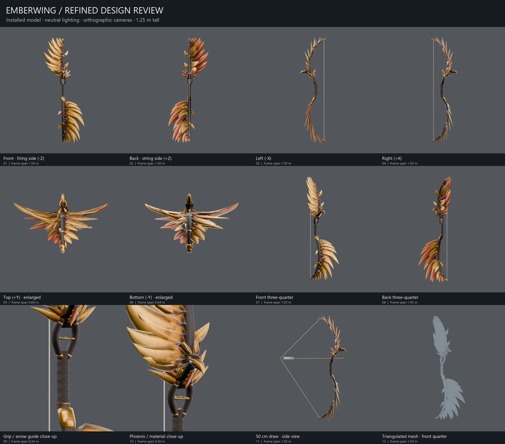

# Emberwing designer review

[Orbit the refined model](https://gratis-postcards-apparently-temp.trycloudflare.com/#emberwing-assembled-review-3e4d3ecbcc31) ·
[Full-resolution overview](https://gratis-postcards-apparently-temp.trycloudflare.com/reviews/Emberwing-refined-review-sheet.png) ·
[Download the complete refined review pack](https://gratis-postcards-apparently-temp.trycloudflare.com/reviews/Emberwing-refined-designer-review.zip)

These are public selected-art links, with no sign-in. The tunnel is temporary:
the PC must remain awake and its URL changes after a tunnel restart.
The 47,428,077-byte ZIP contains twelve 1800 × 1800 PNGs, a labelled overview,
installed bow/arrow/wings GLBs, an assembled review GLB, editable Blender source,
the deterministic bow/flight builders, art handoffs and actual game/hand/night captures. It includes
a short designer brief and numbered feedback questions. No project/service data
or credentials are included.



The six cardinal views, two three-quarter views, grip and phoenix close-ups,
drawn side pose and triangulated wireframe use neutral white studio lighting,
AgX and orthographic cameras. Full bow views share a 1.50 m frame span;
top/bottom and detail views are deliberately enlarged. Camera positions and
frame spans are recorded in the pack's `manifest.json`. The rendered art is the
installed GLB, with a runtime-string approximation. The draw pose adds the real
arrow and modest runtime limb flex. Gameplay, flight/VFX and collision are not
simulated in the orbit showroom; the in-game images provide lighting context.

The installed refined bow's SHA-256 is
`28de7a0bda22f15cfde2e3934ca90069697390db8c546d1f2ee5117bc5c821af`.
This revision implements the designer critique: a solid leather grip and open
arrow window, seated moving string nocks, sculpted bronze/gold phoenix, varied
cambered feathers and layered materials. See [refinement verification](REFINEMENT.md).
The original arrow/wing art and the existing live session were preserved.
[The previous model remains available for comparison](https://gratis-postcards-apparently-temp.trycloudflare.com/#emberwing-assembled-review-a9e99d756861).

## Reproduce from the repository root

```powershell
& tools/blender-4.5.13-windows-x64/blender.exe --background --python-exit-code 2 --python assets/emberwing-sonnet/review_views.py -- --model godot/weapons/emberwing/bow.glb --out outputs/emberwing-refined-review
python assets/emberwing-sonnet/package_review.py --folder outputs/emberwing-refined-review
```

Pillow is required by the packager. Full images and the archive remain in ignored
`outputs/emberwing-refined-review/`; the curated overview and renderer/packager are
versioned here. The packager includes an explicit file allowlist and checks ZIP
CRC and image resolution. The assembled GLB passed the existing asset contract,
Khronos validation and disposable Godot import. Remote verification checked the
new model length, PNG/ZIP sizes and content types, and the overview's SHA-256.

Use the installed `asset-showroom` skill to publish the assembled GLB. For
review-image/download sharing, its static server now accepts `.png` and `.zip`;
copy only the selected overview/archive to
`C:/Users/mog/.codex/asset-showroom/public/reviews/` and verify their URLs.
There is no folder listing or access outside the copied public root. Start,
status and identity-safe stop commands are in that skill; do not stop the game
or unrelated servers. Runtime logs are under
`C:/Users/mog/.codex/asset-showroom/logs/`.

Measured refined rendering: **4.843 s** for all twelve views. Packaging/CRC:
**2.208 s**; assembled-model gate: **2.520 s**; publication: **1.341 s**;
remote review checks: **1.236 s**.
First wireframe render did not apply the view-layer material override. Explicit
mesh materials and a thin wire modifier fixed it; disabling even-offset avoids
long spikes at acute feather triangles. Two earlier tunnel checks failed with
`getaddrinfo` (16.673 / 16.900 s); later DNS lookup succeeded, and the existing
tunnel verified without another restart. Do not treat stale `last-publish.json`
as a verified new URL after failure. Detailed step timing remains in
`logs/work-timing.csv`.
