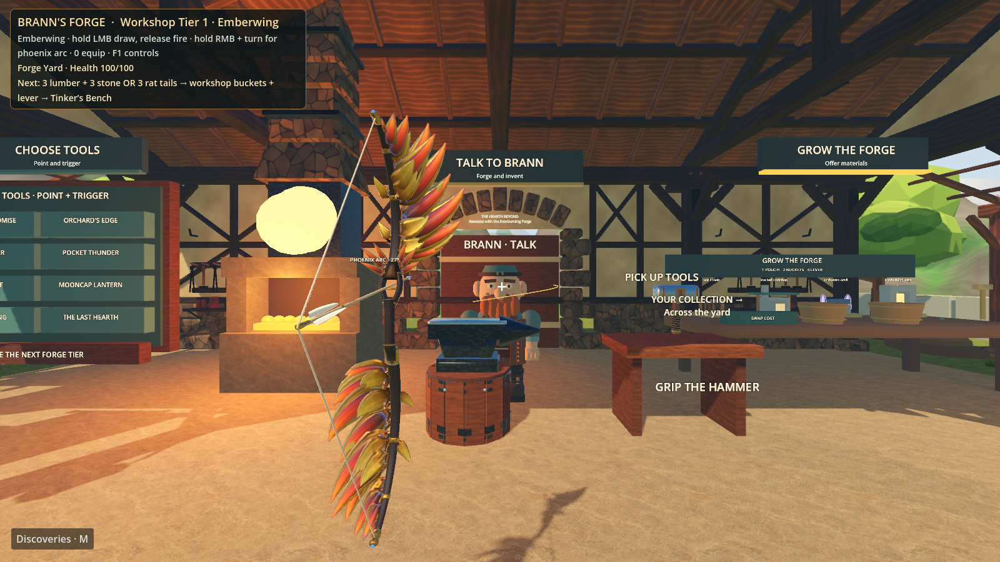
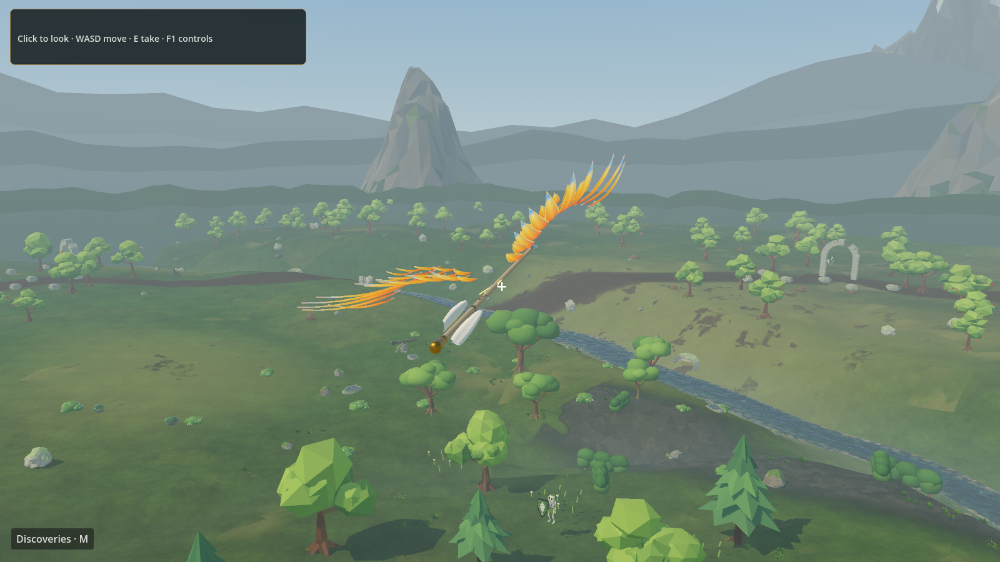

# Emberwing — physical archery and phoenix flight

Emberwing is an original phoenix bow inspired by the supplied Sunfury reference.
It uses conventional wood, steel and feather arrows. Its alternate action bends
the initial flight through a gesture, with phoenix wings banking into the turn;
it does not choose or home towards a target. Arrows retain gravity and drag.





## Find and use it

Relaunch normally to load the new native archery module. The item has a named,
persistent collection stand in the Forge Yard, and the hand menu's **Dev Tools**
offers **Emberwing bow**. Desktop **0** equips that same instance. This is a
playtest addition available immediately, with unlimited quiver arrows.

In VR:

1. Grip the bow with either hand. A back quiver appears while it is held.
2. Reach behind the shoulder with the free hand and hold its trigger to take one
   arrow. For easier practice, the same trigger near the string/rest can take one.
3. Bring the held nock to the arrow rest, then pull back while holding the trigger.
   Release the draw-hand trigger to shoot. The string and limbs flex with the draw.
4. With an arrow nocked, hold the **bow-hand trigger** to establish the initial
   direction. Move, turn or roll that hand to shape the curve. The preview and
   degree readout update as you move. Keep the bow trigger held when releasing
   the draw trigger. Letting go of the bow trigger returns to an ordinary shot.

On desktop, **hold LMB** to draw, then **release LMB** to fire. Hold **RMB** and
turn the mouse to shape a phoenix shot. **E** drops the bow and **F1** shows the
controls. Full draw takes approximately 0.83 seconds and launches at 58 m/s.

Arrow retrieval is local rather than teleporting from the back directly onto the
string. Trigger input is claimed only for archery hands or a free hand within
reach of the rest/quiver; other held tools retain their controls. Opening a menu,
dropping the bow, losing controller tracking or separating the draw hand beyond
reasonable reach cancels the draw. A tiny accidental pull cannot fire.

## Implementation and limits

`godot/phoenix_bow.gd` owns the item, input state, physical draw, string, quiver,
shots and collection integration. `godot/phoenix_flight.gd` is a reusable pure
trajectory/gesture solver shared by flight and preview. Grip axes are explicitly
authored and mirrored for left/right hands; generic secondary grips do not
interfere with the draw hand.

Curving lasts 0.85 seconds, easing into ballistic flight, and is capped at 75°.
Swept ray substeps catch thin surfaces at high speed. Arrows damage ordinary
enemies, training dummies, apples and pumpkins; skeleton headshots multiply
damage. Magical wing presentation does **not** bypass ghosts' fire-only rule.
Embedded arrows follow their impact surface for 150 seconds, capped at 20;
flying arrows are capped at 12 and expire after 12 seconds. Flying arrows retire
on zone travel. These arrows cannot yet be picked up after impact.

Wings use three shared-material surfaces, emissive colour and a bounded scale
transition. They have no per-arrow real-time lights or particle emitters. Four
audio voices provide an original synthesised string pluck. This bounds costs,
but does not establish stereo VR performance or physical comfort.

The back quiver reuses the existing authored quiver body, with bolt fletching
hidden only on the duplicated instance and three conventional arrow visuals.
This is not an additional quiver art commission. There is no live voice-to-bow
compiler; this new engine primitive needs one normal game restart.

## Art provenance and validation

Claude Code was updated from **2.1.282 to 2.1.285** after the older CLI rejected
`claude-sonnet-5-5`. Both successful commissions verified the cleaned child
environment, personal subscription account `fauxgrady@gmail.com`,
`authMethod: claude.ai`, and actual **Sonnet 5.5** session metadata. No API billing,
extra usage or substitute model was used.

Two isolated art passes were reviewed in the actual game. The first passed its
technical gates but looked too much like regular fern fronds. The second used
the actual game capture to create swept feather limbs, a clearer hooked-beak
phoenix bust, darker walnut/leather, weathered brass and deep ember interiors.
The final bow, arrow and wing GLBs all passed Khronos and disposable Godot
asset checks. The final source rebuild reproduced all three GLBs byte-for-byte.

| Asset | Triangles | Surfaces | Materials | GLB bytes |
|---|---:|---:|---:|---:|
| Bow (craftsmanship revision) | 15,732 | 13 | 5 | 1,459,448 |
| Arrow | 1,250 | 5 | 4 | 101,448 |
| Wings | 2,400 | 3 | 2 | 91,080 |

Editable Blender source, builder, contracts, studio renders and the artist's
handoff are retained in `assets/emberwing-sonnet/`. Installed assets, extracted
textures and import descriptors live in `godot/weapons/emberwing/`.

The approved designer critique prompted two further serial Sonnet passes:
physical construction followed by materials/sculpture. The arrow now runs
through an open window above a solid oval leather grip. String sockets belong
to authored limb pivots and remain seated as those limbs flex. The bronze/gold
phoenix has a shaped beak, brow, neck and recessed blue eyes; feather groups
have varied camber and sweep. Wood, stitched leather and an aged metal atlas
add surface definition, while draw/curve emission stays restrained and adds
no lights. [Final hand/night captures and verification](../assets/emberwing-sonnet/REFINEMENT.md).
The arrow and wing GLBs remain byte-identical to their original playable art.

From the repository root, rebuild into a separate output folder:

```powershell
& tools/blender-4.5.13-windows-x64/blender.exe --background --python-exit-code 2 --python assets/emberwing-sonnet/builder.py -- --out "$PWD/outputs/emberwing-rebuild" --all
python scripts/asset_lab.py inspect assets/emberwing-sonnet/bow.json outputs/emberwing-rebuild/bow.glb --out outputs/asset-lab/emberwing-bow
```

Repeat inspection with `arrow.json` / `arrow.glb` and `wings.json` / `wings.glb`
before promoting a new art revision. Do not build over the installed assets.

The focused offline regression passed **38 assertions** covering mirrored grip
axes, input ownership, physical quiver/nocking, release/cancel, conventional
gravity, gesture symmetry/translation/roll, wing banking, preview agreement and
real swept collision with persistent embedding. It also checks the imported
arrow corridor, real leather contact, raised guide, seated moving nocks and
draw/curve emission. Service tests and the full
disposable-fixture integration suite also passed. Run:

```powershell
& tools/godot/Godot_v4.7.2-stable_win64_console.exe --headless --xr-mode off --audio-driver Dummy --path godot -- --phoenix-bow-check
node service/test.cjs
node service/integration.cjs
```

The screenshots above use the installed models and real runtime draw/flight
state. They are game renders, not concept images. Reproduce the draw capture:

```powershell
& tools/godot/Godot_v4.7.2-stable_win64_console.exe --xr-mode off --audio-driver Dummy --path godot -- --desktop-hero-preview=bow --preview-bow-draw --preview-alternate "--preview-output=$PWD/outputs/emberwing/game.png"
```

For the flight capture, replace `--preview-bow-draw --preview-alternate` with
`--preview-bow-flight`. Both exit automatically and use offline diagnostics.

## Timing and remaining acceptance

Measured steps are retained in ignored `logs/work-timing.csv`. CLI update:
10.714 s. First art pass: 358.167 s. Refined art pass: 464.997 s. Final asset
bow/wing gates: 4.550 s. Refined-arrow gate: 2.13 s. Import/promotion: 5.002 s.
Byte-identical source rebuild: 0.876 s.
Focused 28-assertion check: 6.898 s. Full integration: 63.714 s. Initial game
draw/flight captures: 12.057 / 11.897 s. Art and engineering overlapped; their
durations should not be summed as one serial wall-clock run.

Craftsmanship review: structural commission 464.731 s; material/sculpture
commission 574.990 s. Final asset gate 2.519 s; import 4.104 s; 38-assertion
archery check 6.984 s; isolated integration 61.513 s; ten actual-engine
hand/night captures 11.062 s; twelve standard views 4.843 s; all-three-asset
byte-identical rebuild 0.997 s.

Headset acceptance remains: reach behind the shoulder, comfortable left/right
draw alignment, finger mating, arc sensitivity and GPU frame time with several
arrows. The mathematical/control checks and desktop renders do not replace that
physical playtest. No existing live game or voice helper was restarted.
