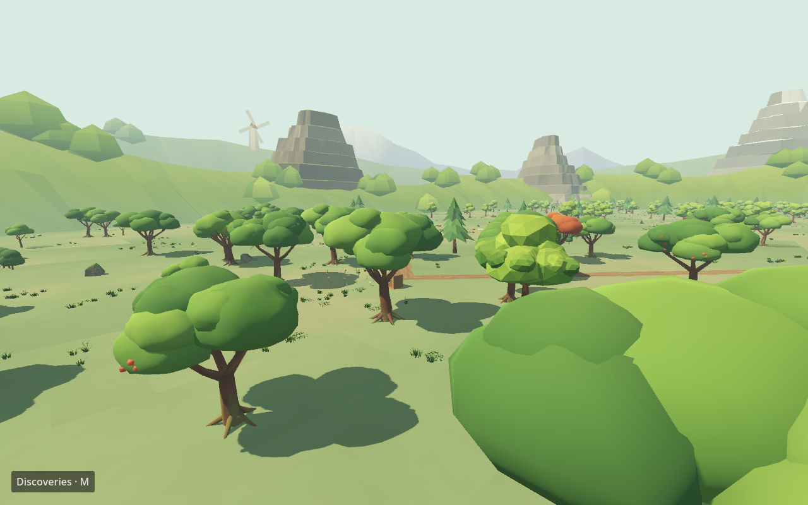
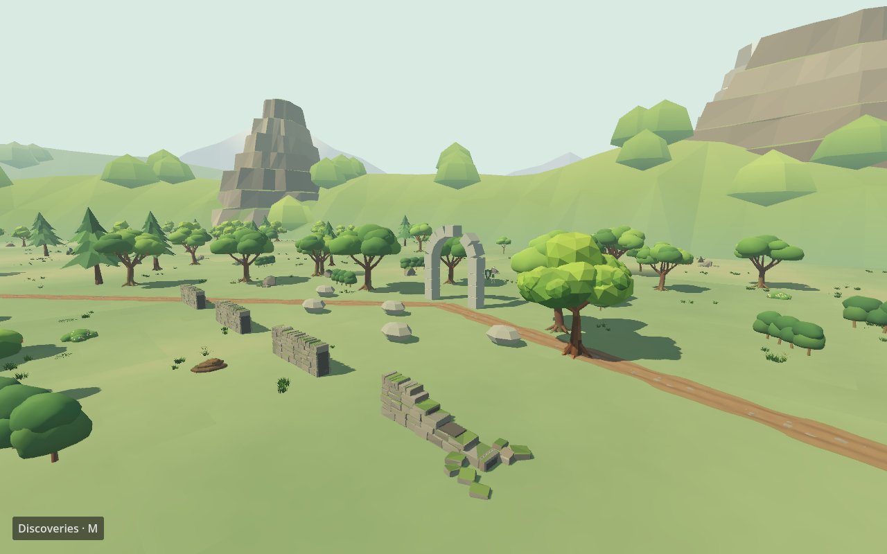

# Apple Orchard expansion — 2026-09-27

The orchard playable square grew from 96 × 96 m (9,216 m²) to 320 × 320 m (102,400 m²), **11.11 times the ground area**. Its centre moved to `(-360, 0, 0)` so the new bounds do not overlap the other zones. The route from Pinewood Ruins remains. The expansion has a seeded loop path and six destinations: Cider Rows, Mossy Terrace, Fallen Walls, Pine Windbreak, Sunward Grove, and Old Overlook. All have a reason to visit: fruit or lumber, three have Mossward skeletons, and two have grapple anchors. The original shootable, edible apples and chop-capable trees remain functional.




## Library and procedural contract

The playable library is in `godot/assets/orchard/`: 23 independent GLBs covering mature/young/seasonal apple trees and LODs, stump, hedge and flowering shrub, two rocks, rubble, three ruined-wall pieces, straight and curved dirt paths, and cliff/snow-peak mountains. `assets/source-commissions/orchard-20260927/` retains the editable Blender file, deterministic builder, asset manifest, validation report, contact sheet, two review renders, and the Opus handoff. All 23 GLBs passed Blender reimport and Godot 4.7.2 import. Two consecutive builds had matching SHA-256 hashes.

`godot/orchard_art.gd` is the reusable adapter. It registers asset IDs, imports parts once, places repeated pieces in 40 m `MultiMesh` chunks, sets visual ranges, keeps far tree silhouettes, and offers `grove`, `trail`, `place_features`, and `upgrade_tree_visual`. `godot/orchard_expansion.gd` owns the seed, loop and plot positions. `godot/orchard_ground.gd` applies cheap world-scale ground colour variation; `godot/ground_kit.gd` scatters 7,200 grass clumps and 120 rocks into chunks while keeping paths clear. The library can dress later generated regions by feeding their placements into `OrchardArt` rather than copying one-off scene nodes.

The 399 decorative grove trees are deterministic, mostly authored and visually batched; they retain simple trunk collision. Plot and original trees keep `TreeKit` interaction and physical fruit, with only their visible crown replaced. This split avoids giving every decorative tree hundreds of active fruit bodies. Objects near paths have detailed models; farther trees use lower-detail meshes or inexpensive silhouettes. Ruin walls, hedges and mossy rocks use simple solid collision proxies. Mountains are visual only.

Godot 4.7.2 imported the first vertex-colour surface of the commissioned GLBs as white. The runtime `godot/orchard_finish.gd` now enables vertex colours on shared meshes before building instances; the source handoff describes a post-import alternative. If future GLBs look white, check this material flag before remodelling.

## Build, checks and visual review

From the project root in PowerShell, after `Setup Tools.ps1` has supplied Godot:

```powershell
& tools/godot/Godot_v4.7.2-stable_win64_console.exe --headless --editor --xr-mode off --path godot --import
& tools/godot/Godot_v4.7.2-stable_win64_console.exe --headless --xr-mode off --path godot -- --expedition-check
& tools/godot/Godot_v4.7.2-stable_win64_console.exe --headless --xr-mode off --path godot --script res://apple_checks.gd
& tools/godot/Godot_v4.7.2-stable_win64_console.exe --xr-mode off --path godot -- --capture=../outputs/orchard-review.png --capture-orchard-plot=2
```

The last capture argument accepts plot indices 0–5. `--expedition-check` verifies the area ratio, no other-zone overlap, plot count, tree and reachable-fruit minimums, and travel. `apple_checks.gd` verifies wobble, detachment, grip, eating, regrowth, bolt strikes and thrown-object hits. **Do not use `--apple-check`: it is not a recognized switch and starts the ordinary game.** This mistaken invocation cost over 35 seconds before the process was stopped; use `--script res://apple_checks.gd`, which completed in 3.84 seconds.

Latest actual results: `EXPEDITION_RESULT [] zones=17 reachable=12`, `APPLE_CHECK_RESULT {"checks":15,"failures":[],"fruit":301}`. At Cider Rows, the desktop capture showed 120 FPS (the application cap) and 411 draw calls; Fallen Walls showed 120 FPS and 242 draw calls. A previous sparse-grove capture had 377 and 224 draw calls respectively, so the extra density has a visible cost. These are **desktop captures**, not a Vive Pro 2 frame-time test. A headset pass is still needed for near/far popping, comfort while traversing 320 m, collision feel and worst-case vegetation cost.

## Commission and timing record

Opus 5.5 was commissioned only for the 3D environment library and asset validation in isolated `work/opus-orchard-20260927`; Codex integrated the game logic and placement. The cleaned Claude child environment had no Anthropic API variables. `claude auth status` verified personal `fauxgrady@gmail.com`, `claude.ai` sign-in and Pro subscription; session metadata reported exact `claude-opus-5-5` and no API-key source. The first attempt hit an OAuth refresh lock after **8.59 s**, with no generation. The sanitized retry completed in **1,011.91 s**. It used subscription allowance, not metered API billing. No publication or credentials were delegated.

Measured material steps retained for future budgeting:

| Step | Outcome | Wall time |
|---|---|---:|
| First Claude launch | OAuth refresh lock; no output or charge | 8.59 s |
| Verified Claude retry and asset build | 23 GLBs, source, renders, validation | 1,011.91 s |
| Godot import of commissioned library | 23 imports, no error | 3.45 s |
| Final expedition fixture after denser grove | Passed | 3.69 s |
| Final apple fixture | Passed | 3.80 s |
| Final Cider Rows desktop capture | Captured, 411 draw calls | 8.98 s |
| Final Fallen Walls desktop capture | Captured, 242 draw calls | 9.04 s |
| First push of final regression commit | Failed: another task had switched active `gh` identity | 0.90 s |
| Re-verify `Moggeth`, switch and push | Synced `main` to the private remote | 3.01 s |

The OAuth lock is a transient CLI credential-refresh collision: do not switch accounts, inject an API key, or change model. Recheck identity in the same cleaned environment and retry the exact model. Source and visual review belong in this project; unneeded working-folder render batches and runtime logs are ignored by Git.

The machine's active `gh` identity is shared across projects. `Repository not found` after a previously successful push was an identity mismatch, not a missing repository. Check `gh auth status` against `git remote -v` immediately before every network Git operation, switch to `Moggeth` for this private repository, and retry the same fast-forward push.
