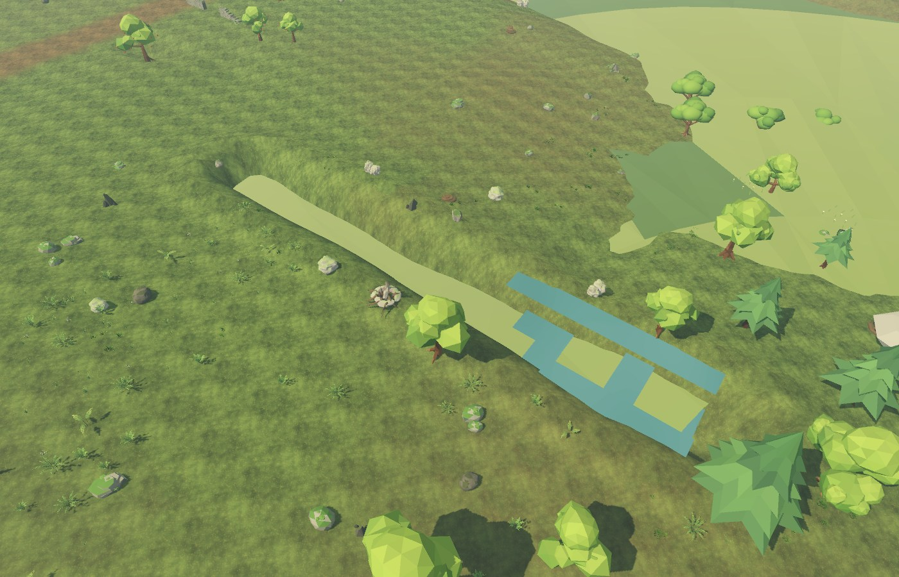
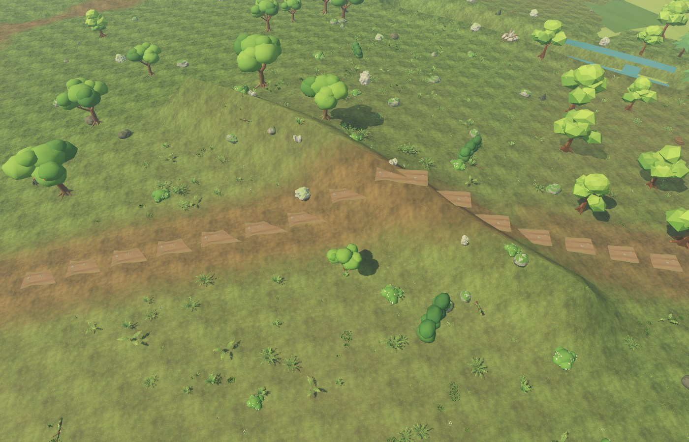
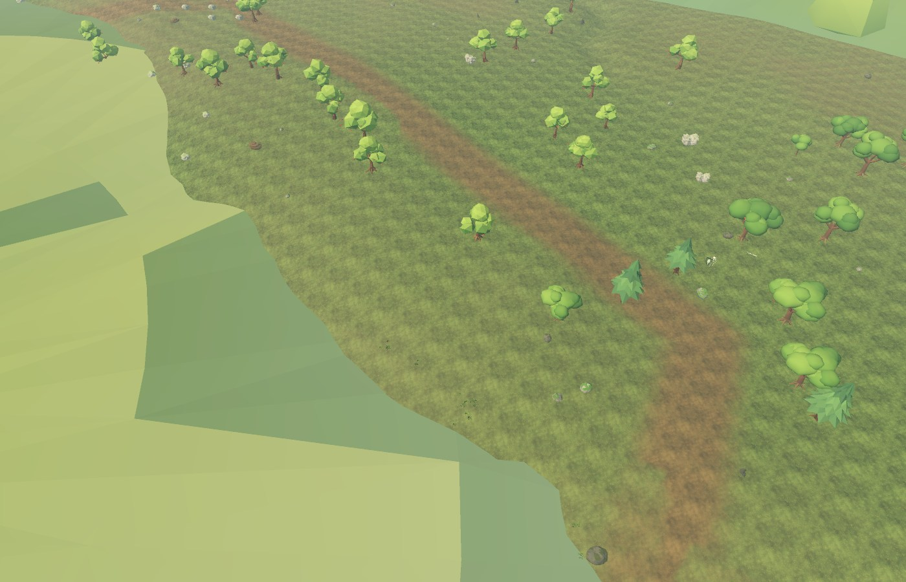
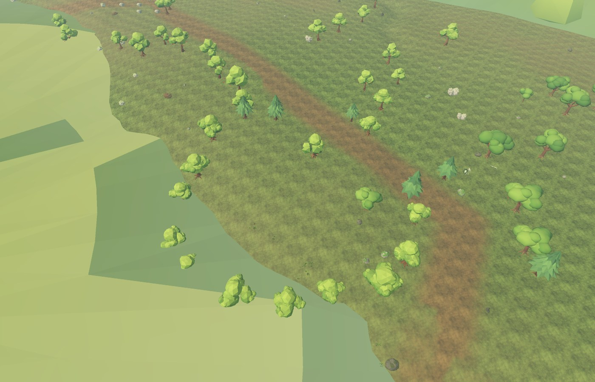
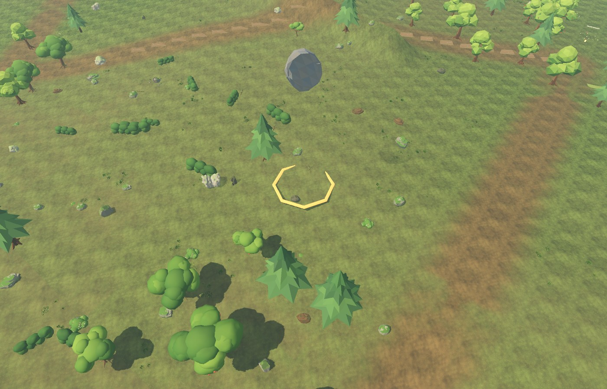
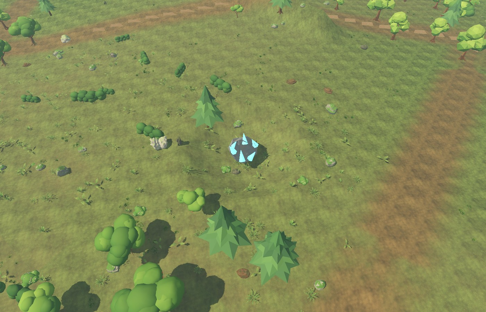
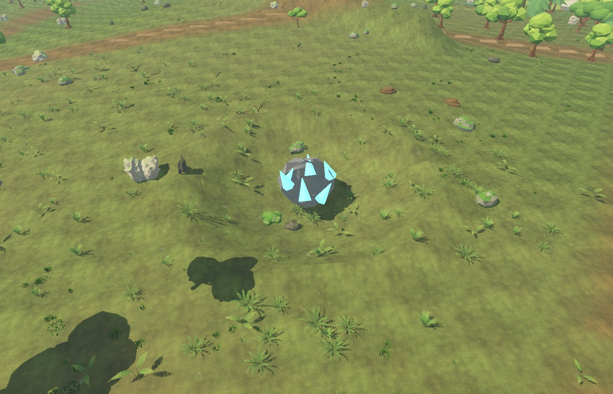
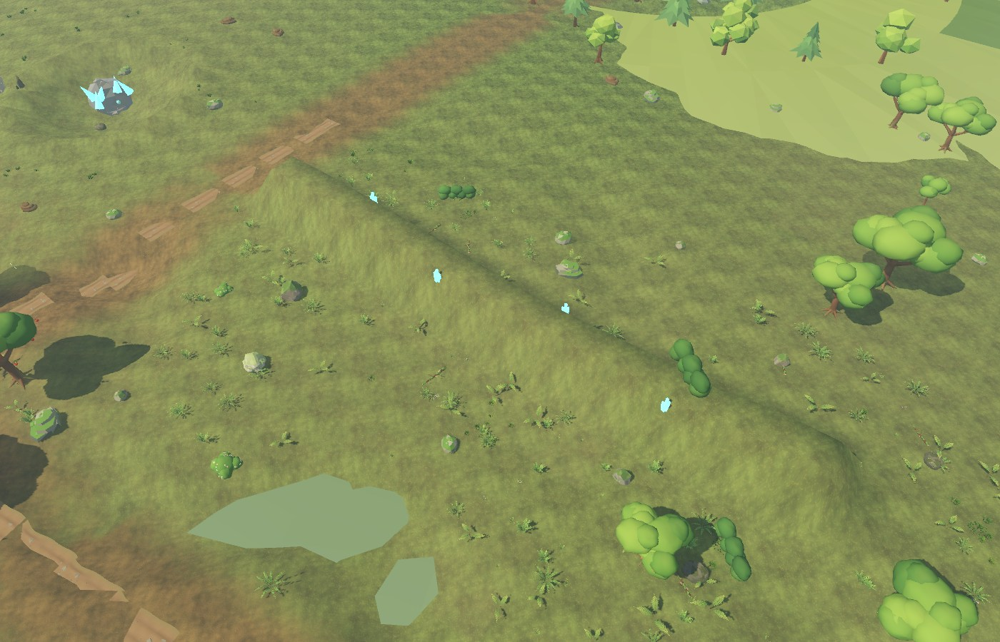

# Terraforming spell gallery

These are captures from the **actual Orchard tactical camera** in a save-isolated Godot session. They show final terrain, not concept art. The Hero in VR or first person and the World Builder see the same scene and collision. The new spell controls are in the World Builder window; a normal game relaunch loads them.

| Spell | Input | Effect |
| --- | --- | --- |
| Sunder | `6`, drag a line | Carves a lasting ravine and raises its shoulders; water only enters from an existing source. |
| Raise Earth | `7`, click | Raises a walkable mound at the chosen location. |
| Grow Forest | `8`, drag a line | Grows a harvestable line of trees. |
| Earthen Wall | `0`, drag a line | Raises a defensive ridge with rock dressing. Costs 4 aether or 2 mined star iron. |
| Tree Ring | `Q`, click | Grows an intentional, harvestable ring of trees around an area. Costs 4 aether. |
| Starfall | `E`, click | Warns the ground, drops a meteor after 1.25 seconds, damages nearby characters, and carves a crater. Costs 8 aether. |
| Crystal Fault | `R`, drag a line | Raises a luminous spired ridge. Costs 2 mined star-gems and 2 aether. |

The first three spells were present in the initial living-landscape slice; the latter four and their material loop are new. Other World Builder controls remain: `1`–`5` for construction/encounter actions and `9` to hire a helper. Click the on-screen spell button if you prefer not to remember hotkeys. Drag spells also accept two clicks. Aether regenerates slowly to its 20-point cap.

### Sunder and Earthen Wall





### Tree Ring, before and after





### Starfall and the material loop







Mine the visible blue veins with **Stonewhisper** (the mining pick) for up to 12 star-gems. Pick strikes elsewhere on the rock yield up to 8 star-iron. The mineable rock, remaining veins, inventory and crater persist between visits. Gem strikes have a deliberately local target; iron strikes are more forgiving. Two gems make a Crystal Fault; two iron can fund an Earthen Wall. Meteorites are capped at ten persistent sites per Orchard to bound collision and save size.

### Crystal Fault



## Reproduce the examples

From the repository root, with the game stopped or separately running:

```powershell
& .\tools\godot\Godot_v4.7.2-stable_win64_console.exe --xr-mode off --audio-driver Dummy --path godot --script res://landscape_spell_gallery.gd --quit-after 700 -- --world-builder-preview
```

The `--world-builder-preview` flag ensures this gallery cannot change the player's save. The generator writes these JPGs to `docs/images/terraforming/`. `landscape_spell_checks.gd` verifies the live Hero damage, terrain height changes, mined resources, persistence records and same-world compiler. See [the architecture and performance handoff](LIVING-LANDSCAPE.md) for the limits of this vertical slice.
