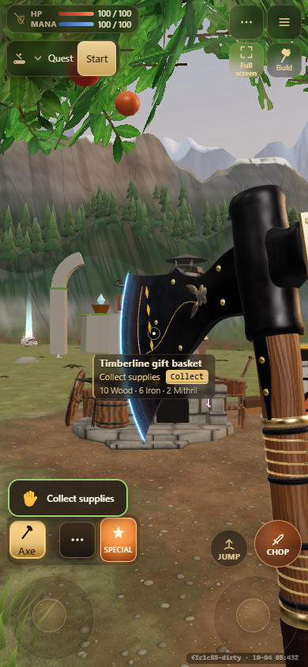
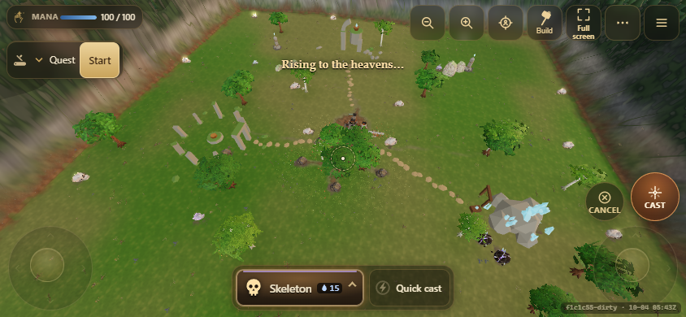
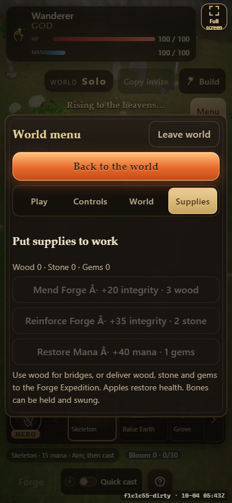
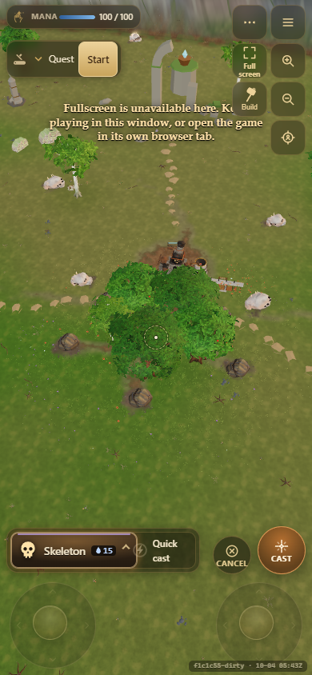

# Touch fullscreen: implementation and acceptance

Based on remote main `f1c1c550b85eaa4ac25f9db355d6bd0322fa6ad2`, in an isolated
checkout. This change owns mobile display controls only; no voice/audio, game
simulation, saves, desktop input or WebXR infrastructure changes.

The existing Full screen button is now permanently in the touch HUD utility area,
including when the tools tray is closed. Portrait layouts use a two-column utility
grid to keep its 44 x 44 CSS pixel target clear of vitals, quests, Build, camera
controls and sticks. It retains the existing icon and gains a visible text label.
It remains available on touch devices even if touch sticks are disabled.

When gameplay input is paused, the same button moves to a safe-area-aware surface
above the menu/lobby. The menu and patch-notes dialog reserve this row. In dialogs
it stays inside their focus scope. Menu card transform/blur effects are suppressed
only while this touch surface is visible: those effects otherwise turn the card
into the containing block for the fixed control. Desktop cards retain their style.

Fullscreen entry occurs synchronously in the activating pointer/keyboard gesture.
No automatic entry, delayed first request, orientation lock or second tap is used.
Standard and prefixed APIs are selected explicitly rather than coalescing their
return values. The actual fullscreen element drives label and pressed state;
fullscreenchange, pageshow, visibility return and resize refresh it. XR suppresses
the touch surface. Unavailable APIs and declined requests leave the button present
and explain how to continue, without changing any browser permissions.

## Browser capability boundaries

- Current MDN compatibility data lists unprefixed requestFullscreen on Chrome
  Android and Firefox Android. Safari's unprefixed API arrived in 16.4 on iPadOS;
  MDN still marks iOS support as iPad-only, with a browser-owned exit overlay and
  swipe gesture. Do not infer arbitrary-element fullscreen support from video
  playback support on iPhone or from an iOS browser brand.
- Runtime feature detection is used instead of user-agent/version guesses.
  Embedding policy and browser decisions can still deny a supported API.
- Installed/standalone display is distinct from API fullscreen. Add to Home Screen
  is only a conditional app-like display option, never a promise to enable the API.

Sources checked 2026-10-04: [MDN API behavior](https://developer.mozilla.org/en-US/docs/Web/API/Element/requestFullscreen),
[MDN browser compatibility data](https://github.com/mdn/browser-compat-data/blob/main/api/Element.json),
[WebKit Safari 16.4 announcement](https://webkit.org/blog/13966/webkit-features-in-safari-16-4/#fullscreen-api).

## Reproduce

Start Vite locally on a free port (used `5195`) and run from `multiplayer/`:

```text
ACCEPT_BASE=http://127.0.0.1:5195 HEADED=1 node tests/browser-fullscreen.mjs
```

The existing browser helper accepts `PW_CORE` (installed playwright-core path),
`PW_CHROME` (Chromium executable) and `BROWSER_QA_DIR` (artifact directory). No
Playwright dependency or browser download was added to the project. Checks use a
disposable local solo world and browser profile, not cloud rooms or existing saves.

The acceptance script exercises real headed Chromium API entry via trusted touch
input, API-driven external exit, button exit, keyboard entry, both roles, tray and
menu states, page-resume events, and responsive layout/hit tests. Denial, missing
API, standalone and legacy WebKit cases are explicitly injected in the disposable
page; those cases are not physical Safari verification. Safe-area offsets are
simulated. Captures show the actual game in Chromium touch emulation.

Physical Android, iPhone, iPad and headset testing remains outstanding. Playwright's
Escape injection did not invoke the browser's native exit action in this environment;
the script records it as unverified, rather than claiming an OS-level key/gesture test.
The browser's real fullscreen exit event and resulting restored control were verified
using document.exitFullscreen. No browser security/permission settings were changed.

## Verification notes

- Final focused browser pass: 64 checks passed in 14.881s; native
  Escape remains explicitly unverified. [Machine-readable results](screenshots/touch-fullscreen/results.json).

- Production build and build:check pass (existing large-bundle warning remains).
- Local Node CI: 123/124 initially passed in 75.6 seconds. The existing patch-notes
  wording check assumes LF when stripping front matter, so Windows `core.autocrlf`
  exposed `pr:` metadata as body text. The check passes with checkout-only LF
  normalization, including the new entry; original tracked files were restored.
  No unrelated test or patch-note changes are included.
- Browser investigation found and fixed an initial patch-notes close-button overlap,
  active-button scaling below 44px, and menu-card transforms displacing the fixed
  surface. Fullscreen assertions await the asynchronous fullscreenchange event.

## Screenshots (Chromium emulation, not physical devices)








